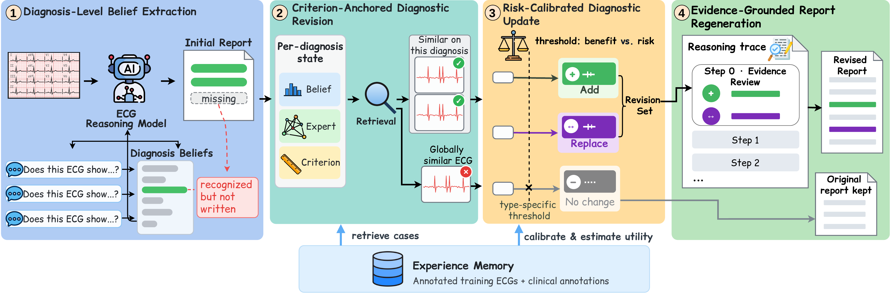

# CADRe: Criterion-Anchored Diagnostic Revision for ECG Reasoning Models

CADRe is an inference-time framework that improves the diagnoses written by a frozen ECG reasoning model. It
elicits the model's belief in each diagnosis, places that belief in a criterion-anchored state together with an
expert judgment and the diagnostic-criterion measurements of the ECG, revises it with confirmed similar cases from an
experience memory under a risk-calibrated update, and lets the same frozen model rewrite its report from the
resulting evidence. **No parameter of the reasoning model is updated.**

<p align="center"></p>

## Method

| Component | What it does | Code |
|---|---|---|
| Belief elicitation | Asks the frozen model *"Does this ECG show X? Answer with one word: Present or Absent."* for 28 diagnoses; the belief is log p(Present) − log p(Absent). The ECG is encoded once and all questions share the cached prefix. | `cadre/ecgr1/beliefs.py` |
| Criterion-anchored state | s_c = [belief b_c, expert judgment e_c, criterion measurements w·m_c], standardized on the memory. e_c is the strongest output of a lightweight 1D-ResNet expert among the statements that name c; m_c are the measurements the diagnostic criteria of c use (intervals, axis, voltages, Q waves, ST/T, rhythm regularity, P waves, pacing spikes). | `cadre/revision.py`, `cadre/anchors.py`, `cadre/measure/`, `cadre/expert/` |
| Experience memory | 28,801 ECGs of the ECG-R1 training corpus with their beliefs, expert outputs, measurements and labels. | `cadre/revision.py` (`Memory`) |
| Risk-calibrated revision | The k nearest memory states give the empirical support p̂; the calibrated belief l is revised to l′ = l + ((1+κ)p̂ − κ)/β. Coexisting findings (22) are added when their calibrated probability reaches the utility threshold; rhythm and axis values form exclusive groups and replace the stated value only under a stricter threshold. | `cadre/revision.py` |
| Evidence-grounded regeneration | The revision set becomes an evidence review ("Step 0") that opens the assistant turn; the frozen model writes its report from there. Records with an empty revision set keep their report. | `cadre/evidence.py`, `cadre/ecgr1/regenerate.py` |

All settings (k, β, κ, w, label source) are selected by patient-grouped 5-fold cross-validation inside the memory;
the selected values are in `configs/cadre.yaml`, and `scripts/06_revise.py --select` reproduces them.

## Results

ECG-Grounding MIMIC-IV-ECG test set (2,381 records), LLM judge DeepSeek-v4-flash with the ECG-R1 rubric:

| Model | DA | Credit | AC | AR | LEV | GEU | EBR | RDP |
|---|---|---|---|---|---|---|---|---|
| ECG-R1-8B-RL | 81.62 | 70.16 | 5.62 | 7.06 | 7.05 | 75.74 | 75.62 | 76.21 |
| **+ CADRe** | **84.97** | **72.79** | **5.82** | **7.18** | **7.17** | **77.13** | **77.11** | **77.51** |

Judge-free diagnosis matching (27 diagnoses, micro-averaged %, `scripts/08_evaluate.py --judge-free-only`):

| Category | Precision R1 / Ours | Recall R1 / Ours | F1 R1 / Ours |
|---|---|---|---|
| **Overall** | 77.6 / 75.1 | 43.5 / **51.7** | 55.8 / **61.2** |
| Conduction | 71.6 / 72.7 | 55.3 / 60.5 | 62.4 / 66.0 |
| Axis | 75.5 / 77.8 | 69.8 / 71.2 | 72.5 / 74.4 |
| Chamber and voltage | 73.3 / 70.3 | 27.2 / 47.2 | 39.7 / 56.5 |
| Infarction | 76.9 / 66.5 | 26.8 / 43.2 | 39.7 / 52.4 |
| Repolarization | 84.8 / 83.2 | 40.7 / 45.4 | 55.0 / 58.7 |

## Installation

CADRe runs the base model through its official code, so install [ECG-R1](https://github.com/PKUDigitalHealth/ECG-R1)
first (its environment provides PyTorch, transformers and ms-swift), then in the same environment:

```bash
pip install -r requirements.txt
```

Hardware used: GPUs with ≥ 48 GB memory for ECG-R1 (generation, belief elicitation, regeneration) and 4 GPUs for
the expert model; the measurement and revision steps run on CPU.

## Data and models

| Resource | Used for |
|---|---|
| [MIMIC-IV-ECG v1.0](https://physionet.org/content/mimic-iv-ecg/1.0/) (PhysioNet credentialed access) | raw 12-lead signals, machine statements |
| [ECG-Protocol-Guided-Grounding-CoT](https://huggingface.co/datasets/PKUDigitalHealth/ECG-Protocol-Guided-Grounding-CoT) | ECG-R1 training corpus (memory), test set, ECG images |
| [ECG-Grounding](https://huggingface.co/datasets/LANSG/ECG-Grounding) | clinical interpretations of the memory, test references |
| [ECG-R1-8B-RL](https://huggingface.co/PKUDigitalHealth/ECG-R1-8B-RL) and its ECG encoder | frozen base model |

Edit `configs/paths.yaml` to point at these locations (or set `CADRE_PATHS=/path/to/your_paths.yaml`). Everything
CADRe writes goes to `work/`.

## Running

```bash
# 1. memory labels and expert inputs (CPU)
python scripts/01_prepare_data.py
# 2. criterion measurements (CPU)
python scripts/02_measure.py --split memory --procs 48
python scripts/02_measure.py --split test --procs 48
# 3. expert model (4 GPUs)
torchrun --standalone --nproc_per_node 4 scripts/03_train_expert.py
# 4. initial reports of the frozen ECG-R1
python scripts/04_generate_reports.py --split memory --gpus 0,1,2,3
python scripts/04_generate_reports.py --split test --gpus 0,1,2,3
# 5. diagnosis-level beliefs
python scripts/05_elicit_beliefs.py --split memory --gpus 0,1,2,3
python scripts/05_elicit_beliefs.py --split test --gpus 0,1,2,3
# 6. revision sets (add --select to re-run the cross-validated selection)
python scripts/06_revise.py
# 7. evidence-grounded regeneration of the revised reports
python scripts/07_regenerate.py --gpus 0,1,2,3
# 8. evaluation (any OpenAI-compatible endpoint; the key is read from an environment variable)
export JUDGE_API_KEY=...
python scripts/08_evaluate.py --base-url http://localhost:8000/v1 --model deepseek-v4-flash
```

GPU steps are sharded over the listed GPUs and resume where they stopped when re-run. Steps 1–5 on the memory are
performed once; for a new ECG, CADRe needs one generation, one belief elicitation, a CPU retrieval, and a
regeneration only when its revision set is non-empty.

## Outputs

| File | Content |
|---|---|
| `work/revision/decisions.json` | per test record: stated diagnoses, additions, replacements (`{"old": "new"}`), calibrated probabilities |
| `work/reports/test_cadre.jsonl` | final reports (`prediction_raw`), whether each was revised, and its evidence statements |
| `work/evaluation/summary.json` | judge metrics with paired-bootstrap 95% CIs, and judge-free scores |

## Repository layout

```
cadre/
  vocabulary.py     diagnoses, belief questions, rules that read diagnoses from text
  data.py labels.py records, memory labels, references
  measure/          signal measurements (two delineation back-ends, axis, voltage, morphology, pacing spikes)
  anchors.py        criterion measurements of each diagnosis
  expert/           1D-ResNet expert model: data, model, training
  ecgr1/            frozen ECG-R1: loading, belief elicitation, generation, regeneration
  revision.py       memory, states, risk-calibrated revision, selection, revision sets
  evidence.py       evidence statements and the Step-0 evidence review
  evaluation/       LLM judge (ECG-R1 rubric), paired bootstrap, judge-free matching
configs/            paths.yaml (data/model locations), cadre.yaml (method settings)
scripts/            01-08 pipeline steps
```

## Citation

```bibtex
@inproceedings{cadre2027,
  title  = {CADRe: Criterion-Anchored Diagnostic Revision for ECG Reasoning Models},
  author = {Anonymous},
  year   = {2027}
}
```

## License

Code: MIT (see `LICENSE`). The datasets and the base model are subject to their own licenses and data use
agreements; this repository contains no data and no model weights.
